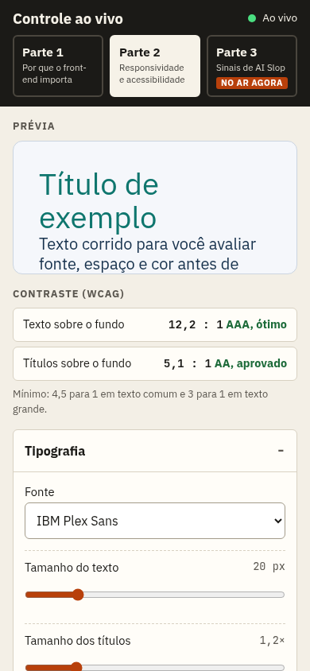

# Front-end ao vivo: do feio ao legível

Apresentação em slides, em HTML, CSS e JavaScript puros, sobre front-end: responsividade, acessibilidade, por que um bom front-end importa e os principais sinais de AI Slop. Sem build, sem dependências para rodar, sem back-end próprio.

O site começa propositalmente feio e ilegível. A plateia escaneia o QR code no canto da tela, abre uma página de controle no celular e altera o site principal em tempo real.



## Como funciona na apresentação

1. Abra o site principal no telão (`index.html`).
2. O QR code, no canto da tela, leva à página `controle.html`, já com o código desta sessão.
3. O conteúdo está dividido em 3 partes. Cada parte tem as próprias variáveis de estilo: fonte, tamanho, espaçamento, cores, bordas, sombras, fundo, inclinação e outras.
4. O grupo 1 edita a Parte 1, o grupo 2 a Parte 2 e o grupo 3 a Parte 3.
5. No botão "Controles" (canto inferior esquerdo, ou tecla `C`), os botões "Parte N: aberta/fechada" liberam ou bloqueiam a edição de cada parte.
6. "Restaurar a bagunça" devolve tudo ao estado feio original.

Atalhos no telão: setas, espaço, `Home`, `End` e as teclas `1`, `2`, `3` para pular entre as partes.

## Publicar no GitHub Pages

1. Crie um repositório no GitHub e envie estes arquivos para a branch `main`.
2. Em **Settings > Pages**, escolha **GitHub Actions** como fonte.
3. Cada push em `main` publica a pasta `apresentacao-grupo-2/public/` (veja `.github/workflows/static.yml`). O endereço final é `https://SEU-USUARIO.github.io/NOME-DO-REPO/`.

Todos os caminhos do site são relativos, então ele funciona na raiz de um domínio e em subpastas, como as do GitHub Pages.

O QR code é gerado a partir do endereço onde o site está aberto. Na hora de apresentar, abra o telão pelo endereço público com HTTPS. Com `localhost`, o celular não alcança a página.

## Testar localmente

Sirva a pasta `apresentacao-grupo-2/public/` com qualquer servidor estático e abra `index.html` e `controle.html` em duas abas:

```
npx serve public
```

ou

```
python3 -m http.server 8000 --directory public
```

Na mesma máquina, as duas abas se sincronizam por `BroadcastChannel`, o que basta para ensaiar.

## Sincronização

A comunicação entre telão e celulares usa WebRTC via [PeerJS](https://peerjs.com), com o servidor público de sinalização. O estado de cada parte fica salvo no `localStorage` do telão, então recarregar a página não perde as edições.

## Estrutura

```
.
├── .github/workflows/static.yml   publicação automática no GitHub Pages
├── docs/prints/                  capturas de tela usadas neste README
├── apresentacao-grupo-2/public/   o site inteiro
│   ├── index.html                slides e telão
│   ├── controle.html             página aberta pelo QR code
│   ├── icon.svg                  ícone
│   ├── assets/
│   │   ├── css/                  apresentacao.css, controle.css, fontes.css
│   │   ├── js/                   config.js (controles), sync.js (comunicação),
│   │   │                         apresentacao.js, controle.js
│   │   └── fonts/                fontes locais (woff2)
│   └── vendor/                   PeerJS e gerador de QR code
├── LICENSE
└── README.md
```

## Licença

MIT. Veja o arquivo `LICENSE`.
